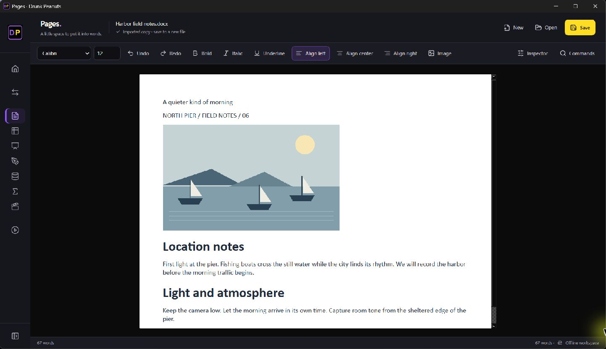
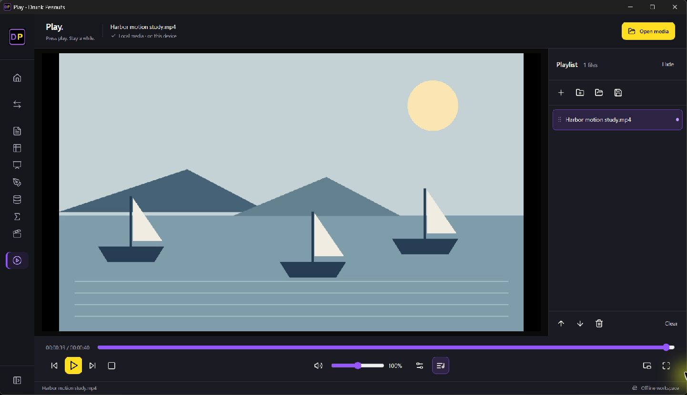

# Drunk Peanuts

<p align="center"></p>

[](https://github.com/Thatweirdguy1/Drunk-Peanuts/actions/workflows/release.yml)
[](LICENSE)
[](#privacy-and-security)

A free, local desktop converter and creative suite for Windows and macOS. Convert files, work with PDFs, images, media, ZIPs and OCR, or create documents, tables, presentations, formulas, drawings, databases, screenplays, and play media with Play.

**Version 0.30.2** extends the Stitch-inspired React interface across **Pages, Tables, Dazzle, Organize, Sketch, Formulaic, Writer and Play**. Tailwind CSS, Lucide icons and the original DP identity bring a shared black, yellow and purple workspace to the desktop suite.

The new React navigation, contextual toolbars, save status, searchable **Commands**, formula bar, scene/table navigation and playlist controls connect directly to the existing native editing canvases and file engines. Use Commands for templates, exports and additional formatting; Inspector reveals contextual native panels. Open With and template launches use the same interface. The converter keeps its native queue; **Home** or **Ctrl+Shift+H** returns without clearing it.

| Pages | Play |
| --- | --- |
|  |  |

[View fresh desktop screenshots of all eight workspaces and PiP](docs/WORKSPACE_GALLERY_0302.md). Screenshots use sample local documents; native editing and playback controls are connected to the desktop engines.

All React assets, icons and the Qt web runtime are bundled locally. Installed users need neither Node nor Python, and the interface needs no server, remote font, account or connection. Home records files explicitly chosen there; clearing its recent list does not delete files. Native save/close safeguards and existing file-format limits remain in place. See the [suite design and integration](docs/STITCH_SUITE_030.md), [Home implementation](docs/DASHBOARD_029.md) and [React source](dashboard).

Play continues to offer editable local playlists, **Picture in Picture** and **volume up to 200%**. Existing OCR, PDF tools, document editing, spreadsheet formulas, presentation mode and Windows Open with handlers remain available. See [Play controls](docs/PLAY_PIP_VOLUME_028.md), [playlists](docs/PLAYLISTS_027.md), [Office batches and limitations](docs/OFFICE_BATCHES.md), and [editable PDF conversion](docs/EDITABLE_OPEN_WITH_026.md).

## Download

Get the app from the [latest release](https://github.com/Thatweirdguy1/Drunk-Peanuts/releases/latest). **No Python installation, terminal, or account is needed.**

| Platform | Download | How to open |
| --- | --- | --- |
| **Windows x64 — installer** | [Drunk Peanuts Setup](https://github.com/Thatweirdguy1/Drunk-Peanuts/releases/latest/download/DrunkPeanuts-0.30.2-Setup.exe) | Run Setup, then use **Drunk Peanuts on your Desktop or Start menu**. Installs for your user, with an uninstaller and Office and media-file registration. |
| Windows x64 — portable | [Portable ZIP](https://github.com/Thatweirdguy1/Drunk-Peanuts/releases/latest/download/DrunkPeanuts-Windows-x64.zip) | Extract the entire folder and open `LocalFileConverter.exe`. Keep the bundled files together. Use the installer for Desktop/Start menu integration. |
| macOS — Apple Silicon | [Apple Silicon ZIP](https://github.com/Thatweirdguy1/Drunk-Peanuts/releases/latest/download/DrunkPeanuts-macOS-Apple-Silicon.zip) | Extract and open `DrunkPeanuts.app`. |
| macOS — Intel | [Intel ZIP](https://github.com/Thatweirdguy1/Drunk-Peanuts/releases/latest/download/DrunkPeanuts-macOS-Intel.zip) | Extract and open `DrunkPeanuts.app`. |

Downloads include FFmpeg, the VLC playback runtime, OCR models, and Office templates. Microsoft Office and LibreOffice are optional external applications. SHA-256 checksums are included with the release.

Windows downloads are **unsigned** and macOS builds are **not notarized**. Your operating system may show a publisher warning or block a download according to its policy. See [installation and signing](docs/WINDOWS_INSTALL_AND_SIGNING.md) for the current status and distribution options.

## Office templates

Choose **Templates** in the main menu, select a workspace and starter, then choose a new filename. The app opens a separate workspace and preserves existing unsaved work. Bundled originals and existing destination files are never overwritten.

The original bundled starters are covered by this repository's MIT license. No Microsoft Office account, paid template subscription, or administrator permission is needed. Save to a folder where you have write access. Third-party templates you import may have their own licenses.

| Workspace | Included starters |
| --- | --- |
| Pages | Report, Letter, Meeting notes |
| Tables | Budget, Task tracker |
| Dazzle | Presentation, Project update, Pitch deck, Research presentation, Lesson plan, Portfolio |
| Sketch | Blank canvas |
| Organize | Contacts |
| Formulaic | Equations |
| Writer's Drafts | Screenplay |


## Included engines

Basic Office conversions run inside Drunk Peanuts using included Python format libraries. For a more faithful PDF, choose **Automatic** or select an installed Microsoft Office or LibreOffice renderer. For cross-format Office conversion, choose installed LibreOffice when available to retain more advanced content. These applications are optional and are **not bundled**. On Windows, automatic PDF rendering prefers installed Word for DOCX, Excel for XLSX, and PowerPoint for PPTX; it then tries installed LibreOffice and finally the built-in basic renderer. On macOS, installed LibreOffice is the optional external renderer. The app reports a failure if a selected external export fails; it does not silently substitute a different PDF.

OCR runs locally using bundled [RapidOCR](https://github.com/RapidAI/RapidOCR) and PaddleOCR-derived ONNX models. The default model recognizes Latin-script languages, Chinese, and Japanese; choose a dedicated Cyrillic, Hindi/Devanagari, Korean, or Arabic model for those scripts. No separate OCR installation, account, or network connection is needed.

The [OCR investigation](ocr-investigation/REPORT.md) records the REA package inspection, model sources, hashes, and recognition checks.

**Play** uses a bundled [libVLC](https://www.videolan.org/vlc/libvlc.html) runtime and plugins in release downloads. You do not need to install VLC separately to play media. When running from source, install VLC Media Player locally so the Python binding can find libVLC. Playback support depends on the VLC build and its plugins; protected media and some discs or streams may require external permissions or hardware.

## What it converts

| Input | Output |
| --- | --- |
| JPG, PNG, HEIC, HEIF, TIFF, GIF, BMP, WebP, SVG, RAW (CR2/NEF/ARW), ICO | JPG, PNG, TIFF, GIF, BMP, WebP, ICO, PDF (where different from input) |
| PDF | PNG, JPG, WebP (one image per page), TXT, editable text DOCX, or visual-page DOCX |
| MP4, MOV, AVI, MPEG/MPG, MKV, WebM | MP4, MOV, AVI, MPEG, MKV, WebM, GIF, MP3, WAV, M4A, AAC, FLAC, OGG |
| MP3, WAV, AIFF, M4A, AAC, FLAC, OGG | MP3, WAV, AIFF, M4A, AAC, FLAC, OGG |
| TXT, DOCX, ODT, RTF | The other document formats and PDF (basic content) |
| CSV, XLSX, ODS | The other spreadsheet formats and PDF (first sheet) |
| PPTX, ODP | The other presentation format and PDF (slide text) |
| Legacy DOC, XLS, PPT | DOCX, XLSX, PPTX respectively, or PDF, using installed Microsoft Office or LibreOffice |
| CSV | TXT (plain CSV copy) |

Legacy binary DOC, XLS, and PPT require an installed Microsoft Office or LibreOffice application; the app does not contain native parsers for them.

## Use

### Creative workspaces

The workspace bar opens these built-in, offline tools:

| Workspace | Create and edit | Local formats |
| --- | --- | --- |
| **Pages** | Rich text, fonts, images, tables, rendered charts/shapes, video links, page breaks | DOCX, HTML, TXT; PDF export |
| **Tables** | Editable cells and formulas; native charts, anchored images, previews and video links | XLSX, CSV |
| **Dazzle** | Object canvas, fonts, images, shapes, charts, tables, embedded video, animations, slide order and fullscreen presenting | PPTX, Dazzle project; PDF export |
| **Formulaic** | Local equation source and preview: fractions, roots, scripts, Greek names | Formulaic source, MathML, OpenDocument Formula; PDF and PNG export |
| **Sketch** | Freehand pen, color, eraser | PNG, JPEG, BMP |
| **Organize** | SQLite tables and records; CSV import/export | SQLite, CSV |
| **Writer's Drafts** | Screenplay writing and preview | Fountain, FDX, PDF, TXT, HTML, Markdown |
| **Play** | Video and audio playback with a playlist, seeking, speed, volume, mute, loop, fullscreen, aspect ratio, audio and subtitle track choices, external subtitles, sync offsets, and audio output selection | Local files supported by the bundled VLC build |

The Office workspaces are local editors with explicit format limits. Unchanged DOCX, XLSX and PPTX imports can be copied byte-for-byte. Pages renders basic Word text formatting, inline images and tables; rich editing refuses unsupported fields/objects rather than silently discarding them. Its charts and decorative shapes are images, and video insertion creates a local link with a poster. Tables writes real XLSX charts and drawing parts while preserving unrelated package entries; video links refer to local files. CSV deliberately retains cell values only.

### Dazzle

Use **Insert** to add text boxes, images, video, shapes, tables, or a column/bar/line/pie/scatter chart. Select an object on the slide or in the **Objects** list. Drag to move it, drag its lower-right handle to resize, or use the position/size/rotation fields. **Object properties** edits text, font family, size and colors; double-click a text box, table or chart to edit its content. **Arrange** changes layering or removes the selected object.

**Design** changes the background color/image and slide transition. Choose **Fade on click** and a duration for an object's entrance. **Slide** moves the current slide up/down; Undo/Redo keeps a bounded in-memory history. **F5** starts fullscreen presenting: Space/Right reveals the next fade or slide, Left returns to the previous slide, Escape exits, and clicking a video opens its embedded content in Play. PPTX and Dazzle projects retain the native presentation package, including inserted media. PDF exports use the editing canvas; animations do not run in a static PDF.

Imported SmartArt, grouped objects, uncommon chart types and advanced animations are preserved in the PPTX package but are not fully editable/rendered by this canvas. Fonts must be installed on the machine. The supported animation authoring is currently on-click fade plus a fade slide transition; this is not full PowerPoint feature parity.

### Document splitter and page organization

Open **Document pages** from the main menu, or **PDF tools → Organize pages visually** with a PDF selected. Drag page cards to reorder; Ctrl/Shift selects several. Use Move up/down, Rotate left/right, or Remove from output, then **Save arranged PDF**. **Extract selection** saves only selected pages. **Split into pages** creates one PDF per page; **Split by ranges** accepts groups such as `1-3;4-6`. Range positions refer to the current arranged order. **Combine PDFs** merges selected PDFs into a new file. Existing output filenames are refused.

This organizer works on PDF pages. Export a Word document, spreadsheet or presentation to PDF first when you need to split its printed pages. New PDF output rewrites document structure, so signatures and complex forms should be checked after organization.


### Play


Select **Play** (previously WatchIT) from the workspace bar, then **Open** one or more local media files. Double-click a playlist item to play it. **Playback options** opens the speed, aspect, audio/subtitle track, sync and output-device settings. Use the timeline to seek and select **Load subtitles** for an external subtitle file. Audio and subtitle sync controls adjust timing in milliseconds; the output selector lists audio devices exposed by the current VLC module. Some devices may not enumerate or work. The player also has volume, mute, loop and previous/next controls. **Space** pauses or resumes, **Left/Right** skips 10 seconds, **F/F11** or video double-click toggles fullscreen, **Escape** exits fullscreen, **M** toggles mute, and **Ctrl+O** opens files. Fullscreen hides the playlist and settings; playback controls hide after inactivity and return when the mouse moves. Media stays local.

The bundled VLC build supports the formats its installed decoding and demux plugins provide, including common MP4, MKV, MOV, AVI, WebM, MP3, AAC, FLAC, and OGG media. No player can guarantee every file with one of these extensions will decode: codec variations, corruption, DRM, and platform decoders affect playback. Play is a player; the separate conversion tools still use FFmpeg and have their own format list above.

### Writer's Drafts

Select **Writer's Drafts** in the main window to write a screenplay locally. The editor uses [Fountain](https://fountain.io/syntax/) as its editable source format, with a live formatted preview, title page fields, scene navigation, a beat map (`#` sections and `=` synopses), character picker, emphasis buttons, dual dialogue, find, and local autosave with crash recovery. **New**, **Open**, and **Save** work with `.fountain`; **Open** also imports Final Draft `.fdx`, plain text, and Markdown. Scripts stay on your device.

Use **Export** to save a separate **PDF, Fountain, Final Draft (.fdx), plain text, HTML, or Markdown** file. Existing export files are not overwritten. PDF uses US Letter screenplay pages by default; HTML is printable in a browser. An unchanged FDX import exports byte-for-byte. For text edits that map safely to the same paragraphs, FDX export retains other XML nodes, attributes, and scene metadata. When paragraphs are added, removed, retyped, or contain multiple styled text runs that were edited, the app asks before producing a new FDX that may lose unsupported metadata. It will not silently claim a lossless round trip.

PDF export from an imported FDX uses supported page size, top/bottom margins, element indents, font size, line spacing, space before, alignment, and start-new-page settings. It keeps scene headings with their following action and character cues with their first dialogue line when they fit. Very long dual dialogue is laid out sequentially to avoid clipping. This is the app's own deterministic layout, not Final Draft's renderer, so matching Final Draft page breaks is not guaranteed. For an exact Final Draft layout, export a PDF from Final Draft and use that PDF as the final copy.

Select an element in the toolbar or press **Ctrl+1–8**. **Tab** and **Shift+Tab** move through element types. Use **Ctrl+B/I/U** for emphasis, **Ctrl+D** to mark a second character cue as dual dialogue, **Ctrl+K** to insert a known character, and **Ctrl+S** to save. **Forward writing** provides optional timed sessions that lock completed lines while the timer runs. The writing tools work offline and need no account.

### File conversion

1. Drag files into the window or select **Add files**.
2. Select each file for a visual image/PDF preview and choose its output format. Mixed formats can share one batch.
3. For an Office file going to PDF, choose its **PDF renderer**. Automatic uses the best installed engine available for that file; Built-in keeps the basic offline converter. PDF to DOCX defaults to **Editable text and images**: normal Word paragraphs plus separate embedded pictures. Single-column pages work best; complex columns, tables, vector art and typography may reflow. Scanned pages need OCR first. **Preserve pages (not editable)** remains available for visual fidelity, and **Text only** omits images.
4. Choose a save folder and select **Convert files**, or press **Shift+Enter**.

The external PDF renderer supports DOC, DOCX, XLS, XLSX, PPT, and PPTX through installed Microsoft Office on Windows, and those formats plus ODT, ODS, ODP, and RTF through installed LibreOffice on Windows or macOS. Legacy DOC/XLS/PPT can also be converted to DOCX/XLSX/PPTX through those applications. Installed LibreOffice can also convert between supported modern Office formats, including DOCX/ODT, XLSX/ODS, and PPTX/ODP; choose it per file in **Conversion engine**. Microsoft Office export uses COM automation; LibreOffice uses its documented headless conversion interface. Existing outputs and source files are not replaced. Running from source on Windows needs the `pywin32` package in `requirements.txt`; release downloads include that support. To select an engine from a terminal, use `LocalFileConverter.exe --convert-with auto input.docx output.pdf` (or `microsoft`, `libreoffice`, or `built-in`). Use `--convert-with libreoffice input.docx output.odt` for cross-format conversion or `--convert-with visual input.pdf output.docx` for visual pages. Plain `--convert` retains the built-in Office renderer; for legacy files it selects an installed application because there is no built-in legacy parser.

The native-app investigation, synthetic fixtures, and measured PDF differences are in [rendering-investigation/REPORT.md](rendering-investigation/REPORT.md). LibreOffice output is compatible, not pixel-identical to Microsoft's PDF. Exact Final Draft pagination still requires a Final Draft PDF export: Final Draft is not installed here, and no supported command-line or automation export interface was established. Writer's Drafts continues to make its own deterministic screenplay PDFs.

For a shortcut, hold **Shift** while dropping files into the app's drop area. A menu at the pointer shows formats shared by those files and anything already queued. Choose one to apply that format to the queue and start conversion immediately into the selected save folder; dismiss the menu to cancel. The shortcut works inside the app window on Windows and macOS.

**PDF tools** merge queued PDFs in queue order, or split, reorder, and rotate the selected PDF. **Image tools** resize to fit within a width and height, crop by coordinates, rotate, or remove metadata from the selected image. Each tool saves a new file in the chosen folder. Animated GIF, WebP, and TIFF files retain every frame when edited and saved in an animated or multipage format.

**Media trim** takes start and end times in seconds. Precise trim re-encodes for accurate cuts; fast trim copies streams and may start at a nearby keyframe. It saves a new file alongside other outputs. FFmpeg is bundled with the app.

**Open ZIP** previews the selected archive's entries and unpacked size, then extracts it to a new numbered folder. Extraction rejects unsafe paths, duplicate names, symlinks, encrypted entries, and archives over 10,000 entries or 2 GB unpacked. Very high compression ratios are also rejected. **OCR to text** asks for the text's script, reads the selected image or PDF, and saves a UTF-8 text file. On a PDF, pages with selectable text keep that text; scanned pages use OCR. Recognition quality depends on the scan, font, script, and page layout. Mixed pages spanning different script families may need separate passes.

For command-line OCR, run `LocalFileConverter.exe --ocr input.png output.txt` on Windows or `LocalFileConverter.app/Contents/MacOS/LocalFileConverter --ocr input.png output.txt` on macOS. Use `--ocr-with cyrillic|hindi|korean|arabic input.png output.txt` to choose a dedicated model. Existing output files are not replaced.

Choose the **Create ZIP** tab and select **Compress to ZIP** to save the queued files in one lossless archive. Files with the same name receive numbered archive names. The **Extract ZIP** tab previews and extracts a selected archive; the **Reduce size** tab exposes the target-size controls.

For upload limits, enter a per-file size in MB and select **Reduce file size**. This creates WebP images, MP4 videos, MP3 audio, or a smaller PDF. The app checks the completed output and reports a failure if it cannot meet the limit. This mode may reduce image quality or dimensions. It first tries lossless PDF stream compression to retain selectable text; if that cannot meet the target, it rasterizes PDF pages and their text is no longer selectable. Animated images retain their frames in reduced WebP output. Office documents are excluded.

Inputs are never overwritten. Existing output names and collisions within a batch get numbered copies, such as `photo (2).webp`. Multi-page PDF image outputs reserve all page names before the batch starts. Conversion and tools run in the background so the interface stays responsive; each item reports its stage and result.

## Run from source

Python 3.11+ and Node 24 (to build Home) are required. Release downloads include their own runtime; Node is only a source-build dependency.

```bash
python -m venv .venv
# Windows: .venv\Scripts\activate
# macOS: source .venv/bin/activate
python -m pip install -r requirements.txt
cd dashboard
npm ci
npm test
npm run build
cd ..
python app.py
```

Run the conversion checks with `python -m unittest -q`. If you have local Office test files in `test docs`, run `python verify_office_fixtures.py` to check one text edit per DOCX, XLSX, and PPTX against copies. Tagged commits build Windows x64, macOS Intel, and macOS Apple Silicon downloads through GitHub Actions. Successful builds create a release draft with installers, archives and checksums; publish it after verifying the downloads. Update `RELEASE_NOTES.md` before tagging.

## Privacy and security

Files stay on your computer. The app has no upload service, analytics, or account. External media tools are launched without a shell, inputs are not replaced, and SVG links to external resources are rejected. It is **not an operating-system sandbox**: format libraries and codecs process supplied files with your user permissions. Only convert files from sources you trust. The bundled macOS app is not notarized.

## Limitations

- Regular PDF to text extracts embedded/selectable text. Use **OCR to text** for scanned or mixed PDFs; pages containing both embedded text and raster text may still omit the raster text.
- Editable PDF to DOCX reconstructs single-column selectable text and embedded raster images. It is not an exact layout engine: vector drawings, complex tables/columns and font substitutions can differ. Rotated or scanned pages require preparation/OCR; use Preserve pages for complete visual fidelity.
- PDF size reduction rewrites the file even when it keeps selectable text; digital signatures should be checked again after conversion.
- Animated GIF, WebP, and TIFF inputs preserve every frame when converted to animated GIF/WebP, multipage TIFF, or multipage PDF. Image tools and target-size reduction retain all frames in supported animated formats. Still-image conversion targets are not offered for animations.
- CSV to XLSX stores values as text; XLSX to CSV exports the active worksheet's displayed values. CSV cannot retain workbook formulas, charts, or sheets.
- Built-in cross-format Office conversion still handles basic content. It refuses many advanced DOCX, XLSX, and PPTX files when it detects content it would discard, such as media, charts, formulas, or extra worksheets. Installed LibreOffice can convert these files with better fidelity, but its output is not guaranteed to match Microsoft Office. Detection is not exhaustive; styling, metadata, or other unsupported parts may still change. The loss-minimizing edits in Pages, Tables, and Dazzle apply when saving back to the same Office format. TXT and CSV are deliberate text/value extraction. Built-in PDF output is a simple rendering of extracted content. External PDF export invokes the selected installed application and depends on its version, fonts, print settings, and license. Check important documents after conversion.
- Large scripts can be opened without a fixed size cutoff, but opening and rendering very large scripts may require substantial memory and may feel slow.
- Legacy DOC/XLS/PPT conversion requires an installed Office application and may change advanced content. Full Excel formula recalculation is not available; Tables calculates only the listed common operations for the selected cell.
- The native engine does not parse Final Draft metadata or reproduce Final Draft's pagination.
- Bundled OCR supports the script choices above, but recognition is not guaranteed for handwriting, damaged scans, unusual layouts, or every language. RapidOCR and its converted PaddleOCR models are distributed under Apache 2.0; see [third-party notices](THIRD_PARTY_NOTICES.md).
- macOS builds are unnotarized and Windows builds are unsigned.

MIT licensed. See [LICENSE](LICENSE).
