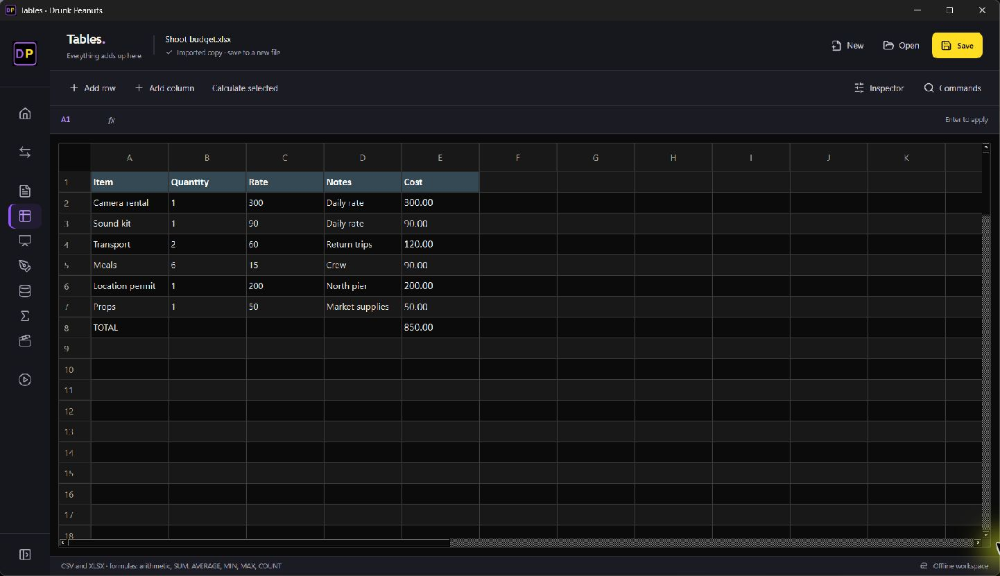
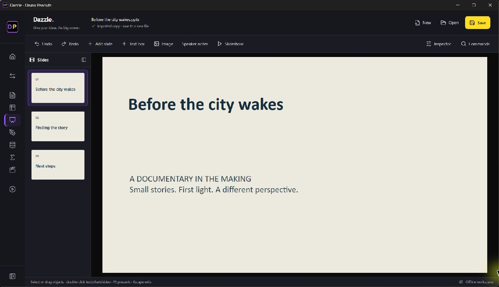
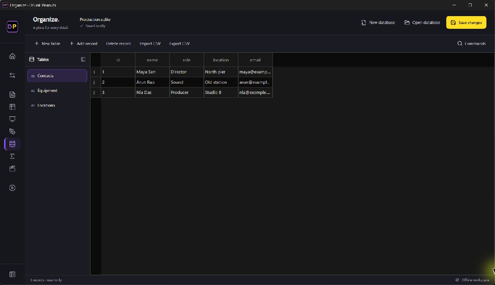
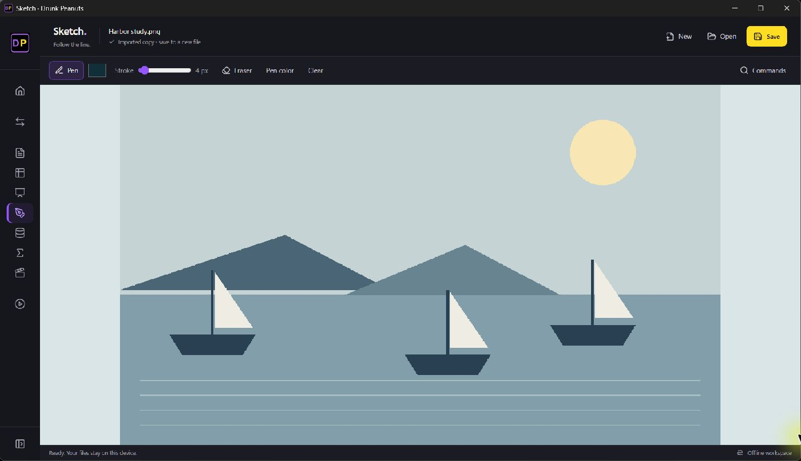
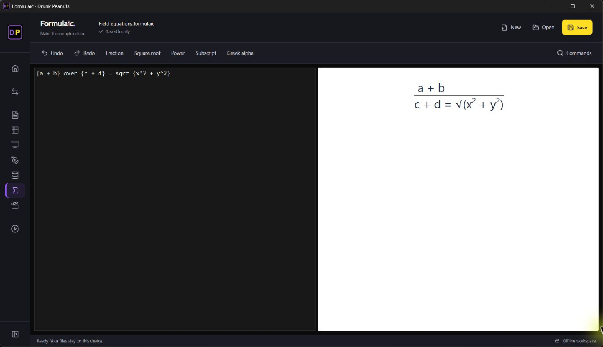
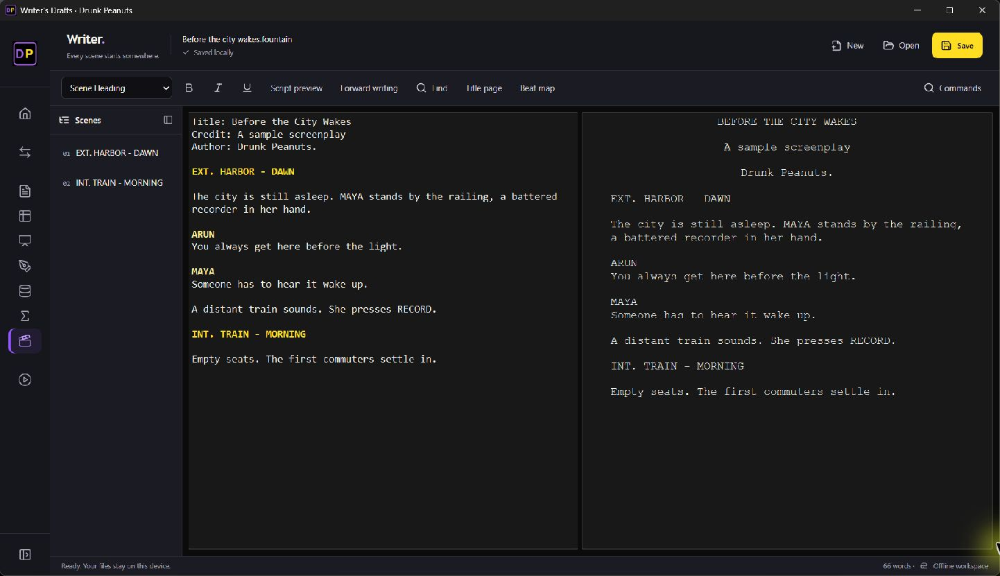
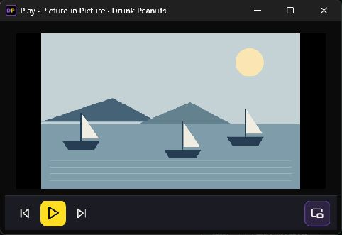

# Drunk Peanuts. 0.30.3 desktop workspaces

Captured from the Windows desktop application using Computer. These are working React controls around native editing canvases, with sample local documents and an original illustration/video fixture. They are not Stitch mockups or browser preview images.

## Pages

## Tables

## Dazzle

## Organize

## Sketch

## Formulaic

## Writer

## Play

Implementation and supported-feature boundaries: [Stitch suite notes](STITCH_SUITE_030.md).
